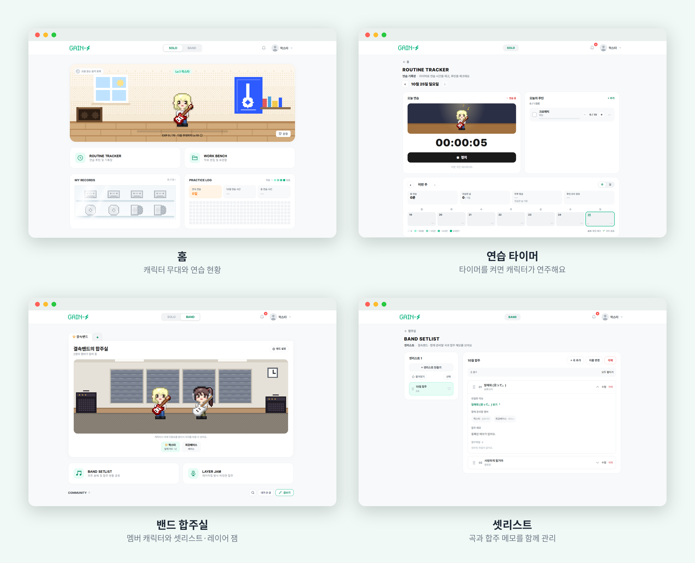
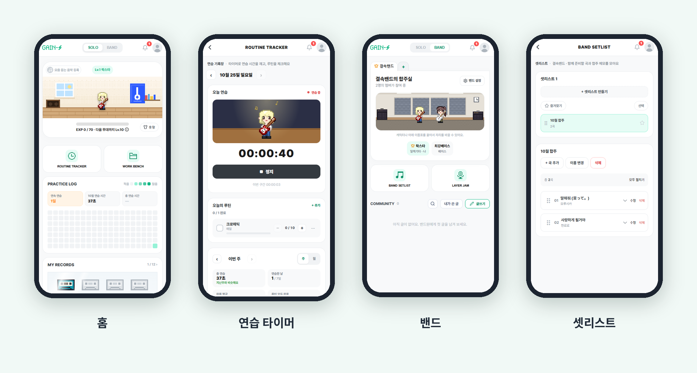

<p align="center">
  
</p>

<h3 align="center">Gain up to Z</h3>

<p align="center">
  연습 기록 · 캐릭터 성장 · 밴드 협업을 한 서비스에서 다루는 악기 연습 플랫폼
</p>

<p align="center">
  <a href="https://github.com/rlatjddms/GAIN-Z/actions/workflows/ci.yml"></a>
  
  
  
  
  
</p>

> 🔗 **서비스**: https://gainz-band.vercel.app  
> 무료 인프라로 운영하고 있어서 응답이 느리거나 일시적으로 중단될 수 있음. 아래 스크린샷으로도 확인 가능.

## 소개

악기 연습을 기록하면 픽셀 캐릭터가 성장하고, 밴드를 만들어 악보·셋리스트·녹음을 나누는 연습 앱입니다.

- **연습 기록**: 연습 시간과 루틴을 기록하면 경험치와 레벨이 쌓이고, 캐릭터의 의상과 무대 배경이 바뀝니다.
- **밴드 합주**: 악보·셋리스트·녹음을 밴드가 한곳에서 관리하고, 각자 시간이 될 때 트랙을 쌓는 레이어 잼으로 자주 만나지 못해도 합주를 이어갈 수 있습니다.

## 주요 기능

- **회원·인증**: 이메일 인증 가입, 구글·카카오·네이버 소셜 로그인, 비밀번호 재설정, 토큰 재발급
- **연습 워크스페이스**: 연습 타이머, 루틴 일일 체크, 연습 캘린더·로그, 경험치·레벨
- **캐릭터 성장**: 픽셀 캐릭터 생성, 레벨별 의상·무대 배경, 옷장, 기록 달성 보상
- **악보**: PDF·텍스트 악보 등록, 페이지 순서 편집, 필기, 타브·코드 악보 렌더링
- **밴드**: 초대 코드 가입, 리더·멤버 관리, 커뮤니티(공지·댓글·첨부), 셋리스트, 레이어 잼(트랙 녹음)
- **소셜**: 친구 코드·요청, 알림과 알림 설정, 프로필 음악

## 스크린샷




## 기술 스택

| 구분 | 기술 |
| --- | --- |
| Backend | Java 17, Spring Boot 3, Spring Security (JWT, OAuth2), JPA, Swagger, JUnit·Mockito |
| Frontend | Vue 3, Vite, Pinia, Vue Router, Axios, pdf.js, PWA |
| DB·Storage | PostgreSQL(운영), MariaDB(로컬 선택), Redis, Supabase Storage |
| Infra | Docker Compose, Render, Vercel, Supabase, UptimeRobot |
| 협업 | GitHub 이슈·PR, Claude Code |

## 아키텍처

```text
사용자 (브라우저 · PWA)
  → Vercel (Vue 3 프론트)
  → Render (Spring Boot 백엔드)
      ├─ Supabase PostgreSQL ........ 데이터
      ├─ Supabase Storage ........... 악보 · 녹음 · 프로필 파일
      └─ Render Key Value (Redis) ... 리프레시 토큰

UptimeRobot → 5분마다 백엔드 호출 (무료 플랜 서버 휴면 방지)
```

- **구조**: 8개 도메인(user, character, practice, sheet, band, friend, notification, record)을 controller / service / repository로 나누고, 공통 응답과 예외 규약을 적용했습니다.
- **인증**: JWT 액세스 토큰과 Redis 리프레시 토큰, 구글·카카오·네이버 OAuth2 소셜 로그인.
- **파일 저장소**: 설정값 하나(`gainz.storage.type`)로 로컬 디스크와 Supabase Storage를 바꿀 수 있습니다.
- **배포**: Render + Supabase + Vercel 무료 플랜 조합. 로컬에서는 Docker Compose로 전체 환경을 한 번에 띄웁니다.

## AI 협업 방식

이 프로젝트는 Claude Code와 협업해서 만들었고, AI가 일하는 방식을 규칙으로 정해서 통제했습니다.

- **요구사항 → 이슈 → PR**: 에픽 아래에 기능 단위로 이슈를 나누고, 이슈 하나당 브랜치와 PR 하나로 작업합니다. PR마다 GitHub Actions가 백엔드 테스트·프론트 빌드·프론트 테스트를 돌립니다.
- **규칙 문서화**: [CLAUDE.md](CLAUDE.md)에 AI의 역할 경계(PR까지만, 머지는 사람), 브랜치·커밋·이슈 규칙, 코드 구조, 에셋 규격을 적어 두었습니다.

| 구분 | AI (Claude Code) | 사람 |
| --- | --- | --- |
| 기획·방향 | 조사 정리, 선택지 제안 | 기능 정의, 우선순위, 채택·보류 결정 |
| 구현 | 코드·테스트·문서 작성 | 동작 확인, 수정 요청 |
| 통제 | 규칙 안에서 작업, PR 생성 | 머지 결정 |
| 운영 | 배포 설정 안내 | 계정 생성, 키 입력 |

## 문서

- [배포 가이드](docs/deploy.md): Render + Supabase + Vercel 무료 배포
- [레이어 잼 조사](docs/layer-jam-research.md): 비동기 합주 녹음·싱크·병합 방식 비교
- [모바일 대응 방식](docs/mobile-strategy.md): 반응형 웹 → PWA → 웹 푸시
- [마디 악보 데이터 포맷](docs/note-data-format.md): 타브·코드 악보 JSON 구조
- [AI 악보 변환 조사](docs/ai-transcription-research.md): 구현은 정확도 문제로 악보 사이트 연결로 대체
- [밴드 게시판 API](backend/docs/band-board-api.md)
- [로컬 실행·설정값·Docker·운영 실행](docs/setup.md)
